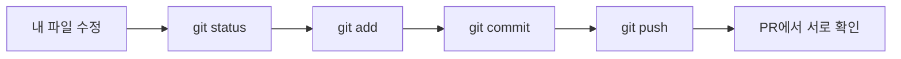
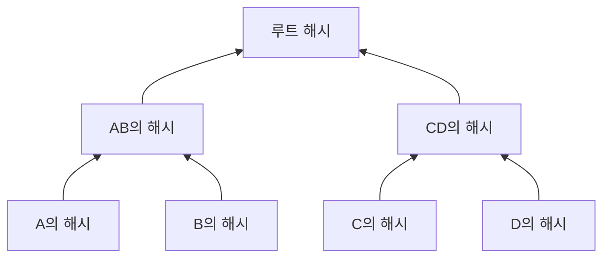
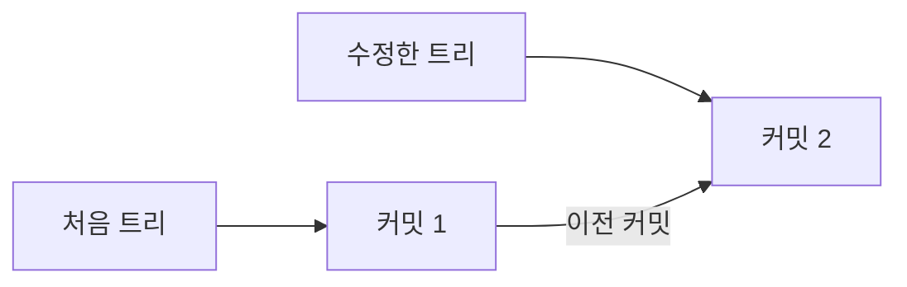
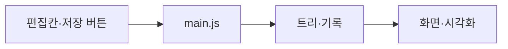

# 작은 이슈 32개

한 이슈는 20~60분을 목표로 한다. 번호순으로 하나씩 진행한다. `트리`는 해시·기록 영역, `화면`은 UI·시각화 영역이다. 둘이 만나는 작업은 `함께`로 표시한다. 새 코드 파일은 해당 이슈에서 만든다. 공부 자료는 [처음 시작하기](START_HERE.md#필요한-만큼-읽는-자료)에 모아 두었다.

## M0 · Git을 써서 첫 파일 올리기 — 1주차



| 이슈 | 담당 | 파일 | 이번에 할 일 | 끝났다는 증거 |
|---|---|---|---|---|
| 01 시작 자료 올리기 | 화면 | `README.md`, `docs/` | 이 문서를 GitHub `main`에 올리고 1학년에게 저장소 주소 전달 | GitHub에서 README가 열린다 |
| 02 저장소 가져오기 | 트리 | 없음 | [복제 안내](https://docs.github.com/ko/repositories/creating-and-managing-repositories/cloning-a-repository?tool=cli)를 보고 `git clone` 실행, 폴더 안에서 `git status` 실행 | `main` 브랜치와 깨끗한 상태를 보여준다 |
| 03 첫 페이지 만들기 | 함께 | `index.html` | `git switch -c issue-03-first-page`로 브랜치를 만들고 제목 한 줄만 보이는 HTML 작성, 로컬 서버에서 열기 | 브라우저에 제목이 보이고 `git status`에 `index.html`이 나타난다 |
| 04 첫 PR 올리기 | 트리 | `index.html` | `git add index.html` → `git commit` → `git push -u origin issue-03-first-page` → GitHub에서 PR 생성 | 화면 담당이 PR에서 파일을 확인하고 `main`에 합친다 |

서로 확인할 것: 1학년이 `add`는 저장할 파일 선택, `commit`은 내 컴퓨터의 기록, `push`는 GitHub로 보내기라고 말할 수 있다.

## M1 · 해시와 머클트리 — 2~3주차



| 이슈 | 담당 | 파일 | 이번에 할 일 | 끝났다는 증거 |
|---|---|---|---|---|
| 05 함수 연습 | 트리 | `src/hash.js` | [함수 설명](https://developer.mozilla.org/ko/docs/Web/JavaScript/Guide/Functions)을 보고 `double(3) → 6` 같은 작은 함수 실행 | 입력과 반환값을 본인이 설명한다 |
| 06 모듈 연결 | 트리 | `index.html`, `src/main.js`, `src/hash.js` | [모듈 설명](https://developer.mozilla.org/ko/docs/Web/JavaScript/Guide/Modules)의 `export`·`import` 부분만 보고 05의 함수를 `main.js`에서 호출 | 브라우저 콘솔에 `6`이 나온다 |
| 07 문자열 해시 | 트리 | `src/hash.js` | [digest 설명](https://developer.mozilla.org/en-US/docs/Web/API/SubtleCrypto/digest)을 보며 `hashText(text)` 작성 | `"A"`를 두 번 넣으면 같은 64자리 16진수 ID가 나온다 |
| 08 한 글자 차이 | 트리 | `src/main.js` | `"A"`, `"B"`의 ID를 콘솔에 출력 | 두 ID가 다르다. 왜 다른지 말할 수 있다 |
| 09 잎 만들기 | 트리 | `src/merkle.js` | 파일 내용 앞에 `blob\0`을 붙여 해시하는 `makeLeaf(content)` 작성 | 같은 내용은 같은 잎 ID, 다른 내용은 다른 잎 ID |
| 10 부모 만들기 | 트리 | `src/merkle.js` | 왼쪽 ID와 오른쪽 ID를 받아 부모 ID를 만드는 `makeParent(left, right)` 작성 | 왼쪽·오른쪽 순서를 바꾸면 결과가 달라진다 |
| 11 트리 완성 | 트리 | `src/merkle.js` | 파일 4개를 A·B·C·D 순으로 받아 잎 4개, 부모 2개, 루트 1개를 반환 | 콘솔에 노드 7개의 ID가 보인다 |
| 12 변경 경로 보기 | 트리 | `src/main.js` | A만 한 글자 바꾼 전후 트리를 출력 | A·AB·루트만 바뀌고 B·C·D·CD는 그대로다 |

서로 확인할 것: A와 C를 각각 바꾸면 어느 부모가 달라질지 먼저 예상한다. 결과를 실행해 예상과 비교한다.

## M2 · 파일 기록 만들기 — 4~5주차



| 이슈 | 담당 | 파일 | 이번에 할 일 | 끝났다는 증거 |
|---|---|---|---|---|
| 13 Git 객체 조사 | 함께 | `src/history.js` | [Git 객체 설명](https://git-scm.com/book/en/v2/Git-Internals-Git-Objects)의 blob·tree·commit 그림을 보고 `{ id, rootId, parentId, message, files, tree }` 샘플 객체 작성 | 앱의 잎·루트·커밋이 그림의 무엇에 대응하는지 설명한다 |
| 14 첫 커밋 | 트리 | `src/history.js` | 파일 4개와 메시지로 `makeCommit` 작성, 처음 `parentId`는 `null` | 첫 커밋의 ID·루트 ID·메시지가 출력된다 |
| 15 다음 커밋 | 트리 | `src/history.js` | 이전 커밋 ID를 새 커밋의 `parentId`에 넣기 | 두 번째 커밋에서 첫 번째 커밋 ID를 읽는다 |
| 16 과거 내용 지키기 | 트리 | `src/history.js` | 커밋에 파일 배열과 트리의 사본 보관 | 현재 A를 수정해도 첫 커밋의 A 내용과 ID는 유지된다 |
| 17 기록 찾기 | 트리 | `src/history.js` | 커밋 ID를 받아 파일 4개를 돌려주는 `getFilesAt` 작성 | 커밋 1·2에서 서로 다른 A 내용을 읽는다 |
| 18 바뀐 위치 찾기 | 트리 | `src/history.js` | 두 트리의 7개 위치별 ID를 비교하는 `compareTrees` 작성 | A만 수정하면 `A, AB, ROOT`가 나온다 |
| 19 같은 내용 저장 | 트리 | `src/history.js` | 직전 커밋과 루트 ID가 같으면 `변경 없음` 반환 | 커밋 수가 증가하지 않는다 |
| 20 첫 코드 리뷰 | 함께 | `src/merkle.js`, `src/history.js` | A와 C를 각각 수정한 경우를 실행하고 결과를 PR에 적기 | 화면 담당이 실행 결과를 확인하고 PR을 합친다. 트리 담당은 `main`을 pull한다 |

서로 확인할 것: `git commit`과 앱의 `makeCommit`을 구분해서 설명하게 한다. 과거 커밋의 파일 배열이 현재 입력과 함께 바뀌는지 살펴본다.

## M3 · 두 사람이 화면 연결하기 — 6~7주차



| 이슈 | 담당 | 파일 | 이번에 할 일 | 끝났다는 증거 |
|---|---|---|---|---|
| 21 편집 화면 | 화면 | `index.html`, `styles.css` | A~D 입력칸, 메시지 칸, 저장 버튼 배치 | 네 파일을 각각 수정할 수 있다 |
| 22 버튼 연결 | 함께 | `src/main.js` | 버튼 클릭 시 입력값을 읽어 `makeCommit` 호출 | 저장 버튼 한 번으로 커밋 ID가 화면에 표시된다 |
| 23 기록 목록 | 화면 | `src/ui.js`, `styles.css` | 커밋 메시지와 ID 앞 8자리를 목록에 표시 | 두 번 저장하면 목록 두 줄이 보인다 |
| 24 과거 내용 | 함께 | `src/main.js`, `src/ui.js` | 목록 클릭 시 `getFilesAt` 결과를 별도 읽기 전용 칸에 표시 | 커밋 1을 눌러도 편집 중인 입력칸은 그대로다 |
| 25 트리 상자 | 화면 | `src/ui.js`, `styles.css` | 잎 4개·부모 2개·루트 1개를 SVG 상자로 배치 | 상자 7개가 A→ROOT 순서로 보인다 |
| 26 연결선과 ID | 화면 | `src/ui.js` | 노드 연결선과 ID 앞 8자리 표시 | 그림에서 자식에서 루트까지 따라갈 수 있다 |
| 27 바뀐 노드 색 | 함께 | `src/main.js`, `src/ui.js`, `styles.css` | `compareTrees` 결과를 화면의 강조 색에 전달 | A 수정 뒤 A·AB·ROOT만 강조된다 |
| 28 커밋 연결 | 화면 | `src/ui.js` | 루트 옆에 선택한 커밋 상자와 이전 커밋 ID 표시 | 트리의 루트와 커밋 기록 관계가 보인다 |

서로 확인할 것: 계산 코드는 `hash.js`·`merkle.js`·`history.js`에 있고, 화면 코드는 `ui.js`에 있다. 한 쪽을 고쳐도 다른 쪽의 규칙이 중복 수정되지 않는다.

## M4 · 처음 쓰는 사람도 사용하기 — 8주차

| 이슈 | 담당 | 파일 | 이번에 할 일 | 끝났다는 증거 |
|---|---|---|---|---|
| 29 입력 안내 | 화면 | `index.html`, `src/ui.js` | 화면에 `1. 파일 수정 2. 메시지 입력 3. 저장 4. 기록 선택` 안내 추가 | 처음 보는 사람이 다음 동작을 알 수 있다 |
| 30 중복 저장 막기 | 함께 | `src/history.js`, `src/main.js` | 빈 메시지 안내, 저장 중 버튼 비활성화 | 빠르게 두 번 눌러도 커밋 하나만 생긴다 |
| 31 다른 사람 사용 | 화면 | `docs/CASES.md`, 화면 파일 | 동아리원 1명에게 설명 없이 사용을 부탁하고 막힌 지점 수정 | 파일 수정→두 커밋→옛 내용 조회를 스스로 완료한다 |
| 32 처음부터 재확인 | 함께 | `README.md`, `docs/CASES.md` | 실행 방법을 README에 적고 새로 연 브라우저에서 전체 흐름 확인 | 다른 PC에서 안내대로 실행해 같은 결과를 본다 |

## 각 이슈를 닫는 기준

```text
예상: 어떤 입력에 어떤 결과가 나올지
확인: 실제로 넣은 입력과 나온 결과
설명: 코드 없이 말한 원리 한 문장
커밋/PR: 링크
```

완료 기준을 보여주면 이슈를 닫는다. 해당 결과가 설명되지 않으면 서로 질문하고 같은 이슈에서 고친다. 다음 기능은 그 뒤에 시작한다.
