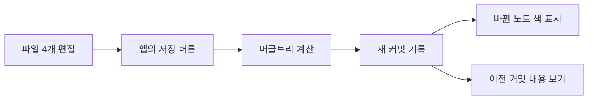

# 프로젝트 설계

## 완성할 기능



화면의 A·B·C·D는 앱 안에서 편집하는 **가상 파일** 네 개다. 아래 파일 구조의 `src/*.js`는 두 사람이 실제로 개발하는 코드 파일이다. 가상 파일은 텍스트만 수정한다. 처음에는 커밋 2개와 변경 경로가 제대로 나오면 완성으로 본다. 파일 추가, 폴더, 브랜치·병합 기능은 이번 앱의 범위에서 제외한다.

## 두 사람의 작업 영역

| 영역 | 맡는 코드 | 서로 확인할 것 |
|---|---|---|
| 트리·기록 | `hash.js`, `merkle.js`, `history.js` | 입력을 바꿨을 때 어떤 ID가 바뀌는지 |
| 화면·시각화 | `index.html`, `styles.css`, `ui.js` | 계산 결과가 화면에 정확히 전달되는지 |
| 연결 | `main.js` | 버튼부터 과거 내용 조회까지 이어지는지 |

이번 프로젝트에서는 1학년이 트리·기록을, 4학년이 화면·시각화를 맡는다. 두 영역 모두 실제 개발 작업이다. 서로의 결과를 실행해 확인한다. 함수가 주고받을 값은 두 사람이 먼저 합의한다.

## 완성 시 파일 구조

```text
Merkle-Tree/
├─ README.md             프로젝트 입구
├─ index.html            파일 입력칸·버튼·결과 영역 (화면)
├─ styles.css            화면 배치·변경 강조 색 (화면)
├─ src/
│  ├─ hash.js            문자열 → SHA-256 ID (트리)
│  ├─ merkle.js          파일 4개 → 잎·부모·루트 (트리)
│  ├─ history.js         커밋 생성·조회·비교 (트리)
│  ├─ ui.js              커밋 목록·SVG 그림 (화면)
│  └─ main.js            버튼과 기능 연결 (함께)
└─ docs/
   ├─ START_HERE.md      입문 자료와 Git 명령
   ├─ PLAN.md            이 설계
   ├─ ISSUES.md          작은 작업 목록
   └─ CASES.md           직접 확인한 입력·기대 결과 (5주차에 생성)
```

코드 파일은 담당 이슈를 시작할 때 하나씩 만든다. 지금 빈 파일을 미리 만들 필요는 없다. 첫 주에 `index.html`, 다음 주에 `hash.js`가 생기는 식이다.

## 코드가 주고받을 값

```text
files = [A내용, B내용, C내용, D내용]
tree = { leaves: [A,B,C,D], parents: [AB,CD], root: ROOT }
commit = { id, rootId, parentId, message, files, tree }

hashText(text) → 64자리 ID
makeTree(files) → tree
makeCommit(files, previousCommit, message) → commit 또는 '변경 없음'
compareTrees(before, after) → 바뀐 위치 목록
getFilesAt(commitId) → 저장 당시 파일 4개
```

해시는 브라우저의 SHA-256을 사용한다. 잎의 입력은 `"blob\0" + 내용`, 부모의 입력은 `"node\0" + 왼쪽 ID + 오른쪽 ID`, 커밋의 입력은 `"commit\0" + 루트 ID + 이전 커밋 ID + 메시지`로 고정한다. `files`는 A→D 순서를 유지한다. 커밋에는 파일과 트리의 **사본**을 넣어 이전 기록을 지킨다. 바로 앞 커밋과 루트가 같으면 `변경 없음`을 보여준다.

앱의 트리는 배우기 쉬운 4잎 이진 머클트리다. Git의 실제 폴더 tree와 저장 형식은 다르다. 이 프로젝트가 사용하는 것은 **내용 해시를 위로 연결하고 이전 커밋을 가리키는 원리**다.

## 8주 마일스톤

| 기간 | 결과 | 이슈 |
|---|---|---|
| 1주 | Git으로 첫 파일을 저장하고 PR까지 경험 | 01~04 |
| 2~3주 | 파일 4개의 머클트리 계산 | 05~12 |
| 4~5주 | 커밋 2개 생성·과거 내용 조회·변경 위치 찾기 | 13~20 |
| 6~7주 | 편집기·기록 목록·SVG 시각화 연결 | 21~28 |
| 8주 | 오류·문구 정리, 다른 사람이 사용해 보기 | 29~32 |

한 번에 이슈 1개를 끝낸다. 주당 4개는 기준이며 이해가 필요한 주에는 다음 주로 넘긴다. 각 이슈는 [작은 이슈](ISSUES.md)에 파일·할 일·완료 조건·학습 링크가 있다.
