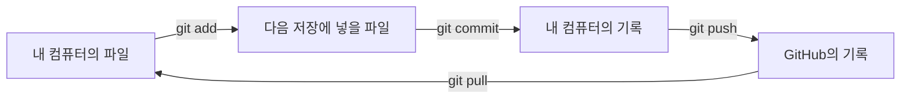
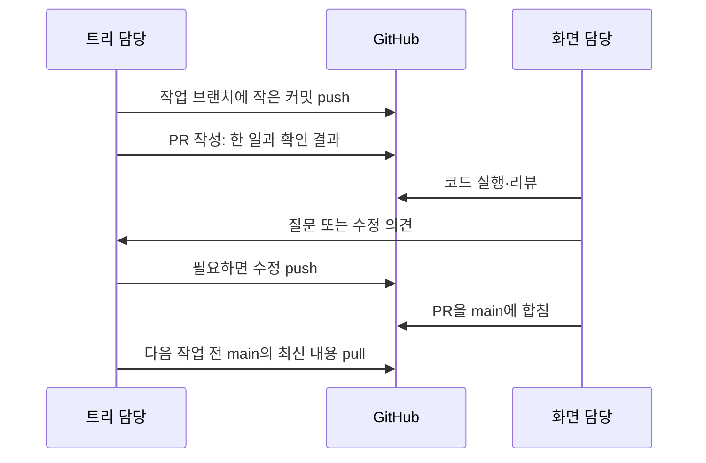
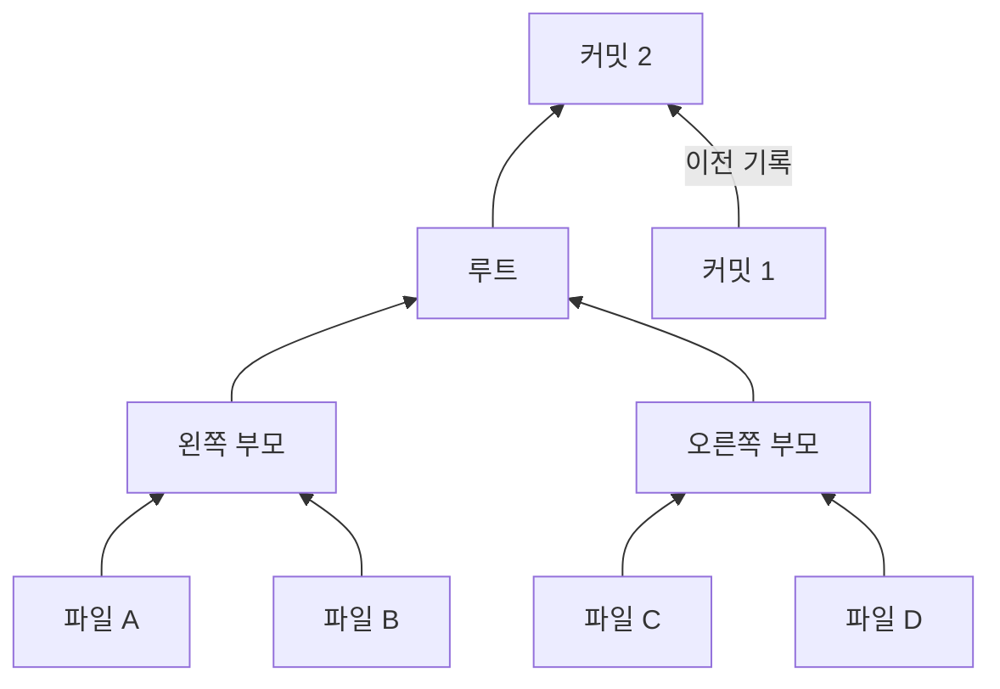
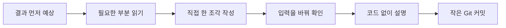

# 처음 시작하기

## Git과 GitHub

| 말 | 뜻 | 이 프로젝트에서 할 일 |
|---|---|---|
| Git | 파일의 변경 기록을 관리하는 프로그램 | 내가 만든 코드의 버전을 남김 |
| GitHub | Git 기록을 함께 보관하고 검토하는 웹사이트 | 서로의 코드를 보고 이슈와 PR을 관리 |
| 커밋 | 그 시점의 변경 사항을 저장한 기록 | 작은 기능 하나를 끝내고 기록 |
| 브랜치 | 독립적으로 작업하는 줄기 | 자신의 작업을 `main`과 분리 |
| PR | 만든 변경을 합치기 전에 보여주는 요청 | 서로 코드를 확인하고 의견 남김 |

웹 앱 안의 **저장 버튼이 만드는 커밋**은 여러분이 직접 구현한 학습용 기록이다. 터미널의 **`git commit`**은 이 프로젝트의 코드 변경을 Git에 저장한다.

## 두 사람이 함께 작업하는 흐름

첫 주에는 둘이 화면을 보며 명령을 함께 입력한다. 이후에는 한 사람이 입력하고 다른 사람이 결과를 확인한다. 작업 중 실수로 상태가 꼬이면 `git status` 결과를 함께 본 뒤 다음 명령을 정한다.

## 첫 모임 전 준비

| 담당 | 준비 | 확인 |
|---|---|---|
| 화면 담당 | 문서를 `main`에 올리고 [공동 작업자 초대](https://docs.github.com/en/repositories/managing-your-repositorys-settings-and-features/repository-access-and-collaboration/inviting-collaborators-to-a-personal-repository) | 트리 담당이 초대를 수락하고 저장소를 볼 수 있다 |
| 두 사람 | [Git](https://git-scm.com/downloads), [Python 3](https://www.python.org/downloads/), 코드 편집기, 브라우저 준비 | `git --version`, `py --version`이 출력된다 |
| 트리 담당 | Git 이름·이메일 설정 | `git config --global user.name "본인 이름"`과 `git config --global user.email "본인 이메일"` 실행 |

Python은 웹 파일을 로컬에서 열기 위한 간단한 서버로 쓴다. 저장소 폴더에서 `py -m http.server 8000 --bind 127.0.0.1`을 실행하고 `http://127.0.0.1:8000`에 접속한다. [Python 서버 명령 설명](https://docs.python.org/3/library/http.server.html)을 참고한다.

## 처음 쓰는 명령

PowerShell에서 저장소 폴더 안으로 이동한 뒤 실행한다. `main`에 첫 문서가 올라온 뒤 트리 담당이 저장소를 복제한다.

| 하고 싶은 일 | 명령 | 확인할 것 |
|---|---|---|
| 저장소 복제 | `git clone https://github.com/alpakalee/Merkle-Tree.git` | `Merkle-Tree` 폴더 생성 |
| 현재 상태 보기 | `git status` | 바뀐 파일과 현재 브랜치 |
| 새 작업 줄기 만들기 | `git switch -c issue-05-hash` | 브랜치 이름 표시 |
| 파일 한 개 저장 준비 | `git add src/hash.js` | `git status`에 staged 표시 |
| 변경 기록 남기기 | `git commit -m "Add hash function"` | 새 커밋 ID 표시 |
| GitHub에 올리기 | `git push -u origin issue-05-hash` | GitHub에서 브랜치 확인 |
| 합쳐진 최신 코드 받기 | `git switch main` 후 `git pull origin main` | 최신 커밋 확인 |
| 최근 기록 보기 | `git log --oneline -5` | 커밋 메시지 목록 |

`git add`에는 **이번 이슈에서 바꾼 파일만** 적는다. `git status`로 확인하고 커밋한다. PR을 열고 합치는 방법은 [GitHub의 PR 실습](https://docs.github.com/en/pull-requests/get-started/pull-request-quickstart)을 따른다.

매주 `main`의 최신 내용을 받은 뒤 그 주의 브랜치를 만든다. 이슈 하나를 끝낼 때마다 작은 커밋을 남기고, 주말에 그 주의 브랜치로 PR 하나를 연다. 두 사람이 같은 파일을 고쳐야 하는 이슈는 함께 화면을 보며 한 브랜치에서 작업한다.

## 앱에서 만들 구조

파일 A의 내용이 달라지면 A, 왼쪽 부모, 루트, 새 커밋의 ID가 달라진다. B·C·D와 오른쪽 부모의 ID는 그대로다. 이 변화를 화면에서 색으로 보여준다.

## 필요한 만큼 읽는 자료

| 읽을 때 | 자료 | 읽고 해볼 것 |
|---|---|---|
| 1주차 | [Git의 기본 개념](https://git-scm.com/book/ko/v2/%EC%8B%9C%EC%9E%91%ED%95%98%EA%B8%B0-Git-%EA%B8%B0%EC%B4%88) | 스냅샷·수정·staged·committed 뜻 구분 |
| 1주차 | [Git 저장소 만들기와 복제](https://git-scm.com/book/ko/v2/Git%EC%9D%98-%EA%B8%B0%EC%B4%88-Git-%EC%A0%80%EC%9E%A5%EC%86%8C-%EB%A7%8C%EB%93%A4%EA%B8%B0) | clone 후 `git status` 실행 |
| 1~2주차 | [JavaScript 함수](https://developer.mozilla.org/ko/docs/Web/JavaScript/Guide/Functions) | 입력 하나를 받아 결과 하나를 돌려주는 함수 작성 |
| 2주차 | [Web Crypto digest](https://developer.mozilla.org/en-US/docs/Web/API/SubtleCrypto/digest) | 문자열을 SHA-256 해시로 바꾸기 |
| 3주차 | [JavaScript 모듈](https://developer.mozilla.org/ko/docs/Web/JavaScript/Guide/Modules) | 파일 간 `export`·`import` 연결 |
| 4주차 | [Git 브랜치](https://git-scm.com/book/ko/v2/Git-%EB%B8%8C%EB%9E%9C%EC%B9%98-%EB%B8%8C%EB%9E%9C%EC%B9%98%EB%9E%80-%EB%AC%B4%EC%97%87%EC%9D%B8%EA%B0%80) | 자신의 작업 브랜치 만들기 |
| 4주차 | [GitHub PR 실습](https://docs.github.com/en/pull-requests/get-started/pull-request-quickstart) | 작은 PR 하나 열기 |
| 6주차 | [브라우저 버튼 이벤트](https://developer.mozilla.org/ko/docs/Learn_web_development/Core/Scripting/Events) | 버튼 클릭으로 함수 호출 |
| 궁금할 때 | [Git 객체 구조](https://git-scm.com/book/en/v2/Git-Internals-Git-Objects) | blob·tree·commit 관계 그림 보기 |

자료를 처음부터 끝까지 외울 필요는 없다. 해당 이슈에서 쓰는 부분을 읽고 바로 짧게 실습한다.

## 한 이슈를 공부하는 방법

예시: `makeParent`를 만들기 전에 `왼쪽 ID와 오른쪽 ID를 바꾸면 결과도 바뀔까?`를 적는다. 함수를 만든 뒤 순서를 바꿔 실행한다. 마지막에 코드 창을 접고 부모 해시가 어떻게 만들어지는지 상대에게 설명한다.

| 시점 | 서로 할 일 | 남기는 것 |
|---|---|---|
| 시작 5분 | 입력 하나와 예상 결과를 말하거나 그리기 | 이슈에 예상 1줄 |
| 작업 20~40분 | 해당 문서의 필요한 부분만 읽고 직접 구현 | 실행되는 작은 코드 |
| 끝 5분 | 입력을 하나 바꿔 보고, 코드 없이 원리 설명 | 실제 결과 1줄과 커밋 |
| 다음 모임 첫 5분 | 지난 이슈를 문서 없이 다시 설명·실행 | 기억나지 않은 부분 1개 확인 |

함수나 Git 명령이 막히면 먼저 `입력 / 기대한 결과 / 실제 결과`를 적는다. 15분 뒤에도 막히면 서로 화면을 보며 한 단계씩 확인한다. AI에는 오류 원인에 대한 힌트나 추가로 확인할 입력을 묻는다. 핵심 함수의 첫 코드는 담당자가 직접 쓴다.

함께 작업할 때는 해당 영역 담당자가 키보드를 잡고, 다른 사람은 예상 결과와 예외 입력을 묻는다. 화면을 만드는 날에는 화면 담당자가 키보드를 잡는다. `main.js`를 연결할 때는 20분마다 바꾼다.

## 마일스톤마다 스스로 확인하기

| 완료한 단계 | 코드나 자료를 보지 않고 해볼 것 |
|---|---|
| Git 첫 PR | 수정 → add → commit → push → PR의 순서 말하기 |
| 머클트리 | A만 바꾸었을 때 바뀌는 노드 그리기 |
| 커밋 기록 | 왜 커밋 1의 파일 내용이 그대로 남는지 설명하기 |
| 화면 연결 | 저장 버튼에서 SVG 색 변경까지 함수 이름 순서대로 말하기 |

설명이 어려운 항목은 다음 이슈로 넘어가기 전에 두 사람이 해당 입력을 한 번 더 실행한다.
